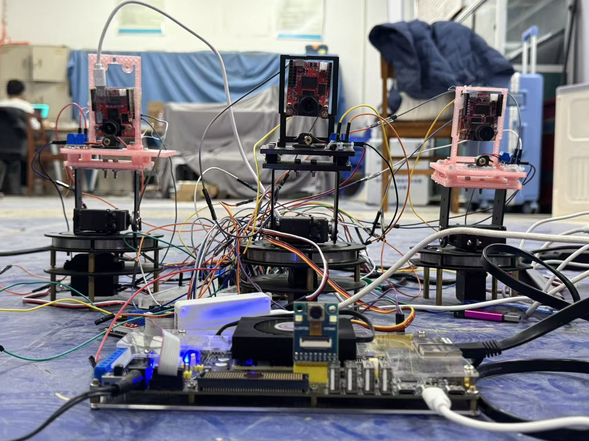

# 多目标视觉闭环指向系统

**FPGA 流式视觉测量与云台接口平台 · 2026 嵌入式芯片与系统设计竞赛 AMD 自主选题**

本项目将固定相机的颜色判定、可选 3×3 多数滤波、像素计数、坐标累加与包围框更新映射到 Zynq PL，在采集路径完成每帧 307200 个像素的统计。OpenMV 提供云台侧局部视觉偏差，STM32 管理观测与控制接口，PC 显示测量结果并运行独立参考核对。

[设计报告](report/design_report.pdf) · [最终交付下载](https://github.com/logic202407-cmyk/zynq-vision-lab/releases/tag/submission-20261104) · [复现说明](docs/reproduction.md) · [结果与证据](docs/results.md) · [Skill](skill/README.md)



## FPGA 的核心作用

| 模块 | 计算与职责 | 输出 |
|---|---|---|
| FPGA 主视场计算 | DVP 字节配对、RGB565 判定、可选多数滤波、帧统计 | 前景计数、X/Y 坐标和、包围框、有效状态 |
| FPGA 结果接口 | 原子快照、跨时钟域传递、UDP 扩展、UART 封装 | 带帧序号的测量；UART 发送器在 PL 内求质心 |
| OpenMV | 独立局部相机图像中的色块观测 | dx、dy、有效标志 |
| STM32 | 两路观测解析、会话及状态管理、控制接口 | 云台接口状态与 PWM 接口 |
| PC | 视频重组、叠加显示、参考计算和记录 | 可视画面、同帧核对结果和日志 |

## 主要结果

| 指标 | 结果 | 测量口径 |
|---|---|---|
| 实时 PL 统计一致性 | 100 / 100 同帧比较一致 | 颜色阈值配置，真实 OV5640 图像 |
| 图像接收速率 | 29.97 FPS | 30 秒收到 899 个完整帧，颜色阈值配置 |
| 滤波配置接收速率 | 29.96 FPS | 60.078 秒收到 1800 个完整帧，独立配置 |
| 两行二值缓存 | 160 B | 640 像素行宽，理论容量，为整帧二值掩码的 1/240 |
| 帧测量扩展 | 32 B | RGB565 整帧像素载荷 614400 B；视频仍保留 |
| 完整顶层资源 | LUT 7.31%，寄存器 2.42% | XC7Z100 目标器件布局布线报告 |

各结果的配置、数据与适用范围见 [结果索引](docs/results.md)。实物平台含三套云台；已验证的运动结果为第一套的手动指令响应。系统的联合视觉闭环和三套云台协同不计入上述已验证结果。

## 快速开始

Python 3.12、Tk 和 Pillow 用于离线检查及 PC 界面；Vivado 2024.2 用于 RTL 仿真和 FPGA 构建。

```bash
git clone https://github.com/logic202407-cmyk/zynq-vision-lab.git
cd zynq-vision-lab
git checkout submission-20261104
python -m pip install -r src/pc/requirements.txt
python tools/check_repository.py
python -m unittest discover -s tests -v
python tools/check_skystar_wiring.py
```

上述命令执行离线检查。相机预览、RTL 仿真、厂商依赖获取及板级工程构建分别见 [复现说明](docs/reproduction.md)。

## 工程目录

| 目录 | 内容 |
|---|---|
| `src/rtl/` | FPGA 像素、帧统计、跨域和接口 RTL |
| `src/pc/` | UDP 视频预览、PL 结果比较与日志工具 |
| `src/prototype/skystar_openmv/` | OpenMV 与 STM32 配套源码，具体构建入口见复现说明 |
| `sim/`、`tests/` | 仿真测试台、软件黄金参考与自动回归 |
| `build/`、`board/` | 构建脚本、时钟约束、接线与器件资料 |
| `data/`、`skill/` | 测试数据契约与可复用验证技能 |
| `report/` | 设计报告、实测证据和 AI 协作记录 |
| `docs/`、`assets/` | 使用说明、结果索引与实物照片 |

设计报告和海报采用同一作品名称。源码及资料的固定版本和附件校验和见 [交付清单](report/submission_checklist.md)。历史计划、联调记录和旧版本资料由 [存档索引](docs/archive/README.md)统一导航。

## 许可与依赖

原创源码使用 [MIT License](LICENSE)。原厂视频工程、商用 IP、工具许可证依各自授权获取；获取位置、版本及使用范围见 [第三方说明](THIRD_PARTY.md)与[依赖清单](docs/dependencies.md)。实物照片由团队提供，保留著作权，供本项目评审及介绍使用。
