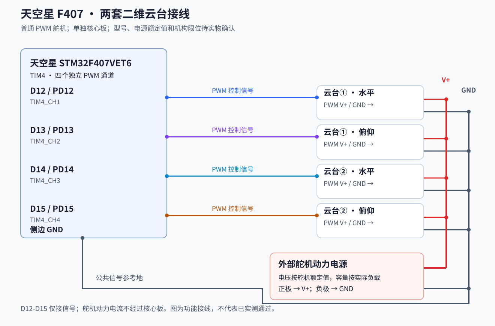
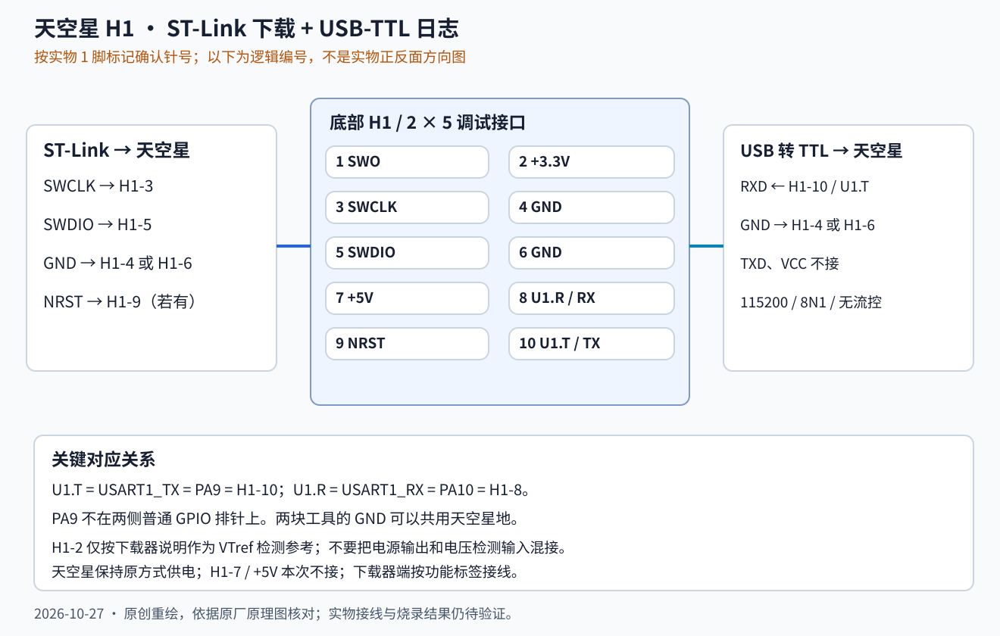

# 天空星 STM32F407：接口资料与两套云台接线

更新：2026-10-27。适用对象：本次讨论使用的**单独天空星核心板**，没有安装电赛扩展板。资料和 Keil 工程对应 STM32F407VET6；本轮未独立读取实物芯片丝印或器件 ID。

本目录保存整理后的接口资料与原创重绘接线图。原厂原理图、引脚分配图和完整资料包通过[官方来源索引](sources.md)获取，不把厂商文件重新标记为本仓库 MIT 原创。

## 当前进度

| 项目 | 截至本次记录的证据 |
|---|---|
| 使用形态 | 用户确认是单独核心板 |
| 两套云台 | 用户确认每套水平、俯仰各一根普通 PWM 信号线，共四根；用户报告已接线 |
| 下载器 | 用户确认使用 ST-Link；USB 转 TTL 用于观察日志 |
| F407 测试固件 | 本地生成 HEX/BIN，Keil 编译 0 errors / 0 warnings，主机逻辑及寄存器模型检查通过 |
| 烧录、PWM 实测、舵机实际动作 | 尚未收到成功结果；本次资料上传没有执行下载、复位或硬件动作 |
| 自动视觉定位、三套同时运行、MOS/光源 | 不属于当前四路 PWM 接线测试的已实现/已验证功能 |

本目录不是上板验收记录。完整阶段说明见[当日记录](../../report/experiments/2026-10-27-skystar-wiring.md)。

## 两套二维云台 = 四个舵机

一个普通 PWM 舵机使用一根控制信号线。每套二维云台有水平、俯仰两个轴，因此两套云台共需四路 PWM；另外还有舵机电源正负极，不能省略共地。

| 云台/轴 | 天空星侧边排针丝印 | MCU 引脚 | 定时器通道 |
|---|---|---|---|
| ① 水平 | D12 | PD12 | TIM4_CH1 |
| ① 俯仰 | D13 | PD13 | TIM4_CH2 |
| ② 水平 | D14 | PD14 | TIM4_CH3 |
| ② 俯仰 | D15 | PD15 | TIM4_CH4 |

- 四根控制线分别接上表四个引脚。适用于普通 PWM 舵机，不适用于 RS-485 A/B 或串口 TX/RX 电机。
- 四个舵机正极接符合其额定电压的外部动力电源，负极返回该电源负极。
- 天空星 GND 接同一个电源负极，作为信号参考地；舵机大电流回路不要经过核心板或串口地线。
- 舵机型号、额定电压、峰值电流、实际机械限位仍待记录，不能从 PWM 接法推断全部为 5V。
- 天空星继续按原方式供电；本测试不连接 MOS/光源。需要对外部模块供电时另行核对模块资料。

## 底部 10 针调试接口 H1

**PA9 不在两侧普通 GPIO 排针上。** 它在底部 H1 调试接口，标为 `U1.T`（USART1_TX）。旁边的 `U1.R` 是 PA10/USART1_RX。

| H1 针号 | 信号 | 本次用途 |
|---|---|---|
| 1 | SWO | 不使用 |
| 2 | +3.3V | 仅在下载器需要目标电压参考时按其说明使用 |
| 3 | SWCLK / PA14 | ST-Link SWCLK |
| 4 | GND | ST-Link 或 USB-TTL 地 |
| 5 | SWDIO / PA13 | ST-Link SWDIO |
| 6 | GND | ST-Link 或 USB-TTL 地 |
| 7 | +5V | 本次不连接 |
| 8 | USART1_RX / PA10 / U1.R | 当前测试固件不接 PC 命令，不连接 |
| 9 | NRST | ST-Link 有 NRST 时建议接入 |
| 10 | USART1_TX / PA9 / U1.T | USB-TTL RXD |

图中的针号是逻辑编号。实物先找 1 脚标记；不能把原理图左右方向直接套到正面或背面。ST-Link 端以功能标签接线，不假定不同型号下载器的排针顺序相同。

### USB 转 TTL：当前只接两根线

| USB-TTL | 天空星 |
|---|---|
| RXD | H1-10 / U1.T |
| GND | H1-4 或 H1-6，也可用侧边 GND |
| TXD、VCC | 不接 |

确认转换器信号电平为 3.3V。串口参数为 **115200，8 数据位，无校验，1 停止位，无流控**。板上的 Type-C 不默认等于这个 TTL 日志接口。

### ST-Link：SWD 下载

| ST-Link 功能 | 天空星 H1 |
|---|---|
| SWDIO | 5 |
| SWCLK | 3 |
| GND | 4 或 6 |
| NRST（若有） | 9 |

天空星已有独立供电时，不把下载器的 3.3V/5V **电源输出**再并到板上。若下载器有明确标注的 VTref/VAPP 目标电压检测输入，按其说明接 H1-2；电压检测输入与供电输出不能混为一谈。

## 本地测试固件的行为

本次固件名称为 `skystar_dual_pwm.hex`。它是队友 [F103 两路 PWM 驱动](https://github.com/logic202407-cmyk/zynq-vision-lab/blob/aafbb9bd62a91028b573b02389ceb714f8e43481/src/prototype/stm32_openmv_gimbal/stm32/User/servo.c)向 F407 四通道的适配，当前用于独立接线测试。本次资料提交不包含原厂 SDK、完整本地工程或固件二进制；[校验信息](bench_evidence.json)用于核对队内交付的同名文件。

程序初始化后四路 PWM 关闭，D12-D15 置低；MCU 复位期间仍是芯片默认引脚状态。按板载 **KEY / WKUP（PA0）**，短按松开后执行下一步，各步之间等待至少 2 秒。

| 短按步骤 | 输出命令 |
|---|---|
| 1 | 四轴输出基准脉宽：水平 1450us、俯仰 1500us |
| 2 | 仅 D12 增加 100us，800ms 后自动回基准 |
| 3 | 仅 D13 增加 100us，800ms 后自动回基准 |
| 4 | 仅 D14 增加 100us，800ms 后自动回基准 |
| 5 | 仅 D15 增加 100us，800ms 后自动回基准 |
| 6 | 四轴保持基准 |
| 7 | 关闭四路 PWM，下一次短按从步骤 1 重新开始 |

任意阶段长按约 1 秒关闭 PWM；松开不会重新启用。30 秒没有短按，也会关闭 PWM 并重置步骤。关 PWM 不等于切断舵机动力电源。基准脉宽不等于已经标定的机械零位或实际 90 度。

驱动由 F103 的 TIM2/PA0-PA1 迁移为 F407 的 TIM4/PD12-PD15。TIM4 按 APB1 实际配置计算时钟；在 HCLK=168MHz、PCLK1=42MHz 的正常配置下，TIM4=84MHz、PSC=83、ARR=19999，计数单位 1us，PWM 周期 20ms。没有照抄 F103 的预分频 71。真实频率与脉宽仍待示波器/逻辑分析仪验证。

## ST-Link 烧录与下次继续步骤

以下是准备好的操作说明，**不代表已经执行**。

1. 烧录时先断开舵机动力电源，天空星按原方式供电；BOOT0 不按住。连接上面的 ST-Link SWD 线，USB-TTL 日志线可保留。
2. 打开本地四路 PWM 测试工程，目标选 `Skystar_Dual_PWM`。不要误开旧 MaixCAM 工程。
3. Keil `Options for Target → Debug` 选择 `ST-Link Debugger`，`Settings` 中 Port 选 `SW`，初始时钟可用 1MHz。应先识别到目标，而不是直接反复点下载。
4. `Flash Download` 检查 STM32F407VE 对应 512KB 内部 Flash 算法（`STM32F4xx_512.FLM`，起始 `0x08000000`、大小 `0x80000`）；启用 Program、Verify、Reset and Run，擦除范围采用所用扇区。`Utilities` 使用所选调试驱动。
5. F7 编译当前目标，再用 `Flash → Download`。出现编程和校验成功信息后，按 NRST 复位运行；USB-TTL 以 115200 / 8N1 看日志。
6. 确认启动标识 `SKYSTAR F407 FOUR-PWM BENCH 2026-10-27` 和 `D12=PAN1 D13=TILT1 D14=PAN2 D15=TILT2`。程序默认 PWM 关闭。
7. 接通符合额定值的舵机动力电源，按上面的步骤逐轴记录实际动作。若机构顶住或异常持续鸣响，断开舵机动力电源。

下次需要补的证据：下载成功日志、D12/D13/D14/D15 实际对应轴与正方向、四路 PWM 周期/脉宽、电源电压及异常复位情况。当前先完成两套；第三套和三路视觉集成另行开发与验证。

## 后续三套的候选资源，不是当前已完成接线

F407 可规划 USART1 调试、USART2/3/6 分别接三路 OpenMV、UART4 PC10/PC11 接 FPGA；PC10/PC11 与 TF/SDIO 复用，应避开 TF 功能。第三套 PWM 曾候选 PE9/PE11（TIM1 CH1/CH2），当前四路测试驱动未实现这两个通道。

原天空星 MaixCAM 工程中 USART3 被 X42S 使用、USART6 为串口屏预留；不能把候选资源表当作现有固件行为。MOS 模块信号、功率供电和复位默认状态尚未确定，不在本图中分配引脚。
