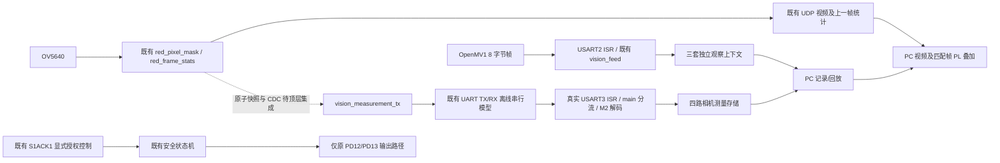

# C1 三套云台视觉测量集成

本版是离线观察候选，不是六轴控制固件。基于 B2 `078a7cf7b191fc27dc14f982781505aa291b3c64`，保留 S1ACK1、双通道 PWM 公共使能、500 ms 租约及 200 ms 部分命令超时。只有定义 `C1_OBSERVATIONS` 才编译 main 中新增接收分流及状态镜像；默认 B2 行为不变。

## 数据边界

实线表达模块数据方向，不表示已经完成板级接线或时钟域集成。C1 验收把 XSim 产生的串行字节送入实际 C ISR/解析器，是文件驱动的顺序端到端测试；不称为同时运行的 RTL/C 联合仿真。B2 的同时桥接独立回归。

M2 无调用 arm、safety_command、board_outputs 的路径，也不续租。它不驱动 PID。OpenMV 的额外观察解析器独立于原 SAFE_AUTO 解析器；原自动模式仍受既有安全协议控制。当前没有增加 FPGA/OpenMV 竞争控制器。

## M2 测量格式（本版已实现）

既有 M1/CRC32 文档保持 planned。M2 使用独立版本，不修改 S1ACK1 字段或 B2 测试期望。所有多字节数为大端无符号数。

| 偏移 | 字节数 | 内容 |
|---|---:|---|
| 0 | 2 | A5 5A |
| 2 | 1 | 版本 2 |
| 3 | 1 | 类型 1：测量 |
| 4 | 1 | camera_id，0..3 |
| 5 | 1 | bit0 帧完整；bit1 目标有效；bit2 采集 tick 可用，其余零 |
| 6 | 1 | origin 1=PL，2=PC_REFERENCE；当前 STM32 存储与 PL UI 槽只接受 1 |
| 7 | 1 | 既有 mask_version 1/2 |
| 8 | 8 | 非零日志 session，必须显式绑定；不是运动 nonce/epoch |
| 16 | 4 | 原始帧序号，严格递增，溢出必须重新绑定 |
| 20 | 4 | 采集 tick；不可用时为 0，不能与 PC 时钟直接比较 |
| 24 | 2+2 | width / height，最大 640×480 |
| 28 | 4+4+4 | count / sum_x / sum_y |
| 40 | 2×4 | xmin / ymin / xmax / ymax，闭区间 |
| 48 | 2+2 | floor(sum_x/count)、floor(sum_y/count) |
| 52 | 2 | CRC16-CCITT-FALSE，init FFFF/poly1021，无反射，无 xorout，覆盖字节0..51 |

有效目标必须完整、count>0、质心及 bbox 在画面内且相互一致。无目标/不完整时几何字段全部归零，用 valid 区分真实 `(0,0)`。当前 RTL 与 Python 编码器保留全局红色像素统计，不伪称最大连通域。

共享现有行解析器的实际线格式：`v2 ` + 108 个小写十六进制字符 + LF（112 字节）。前缀独立分流，不会作为运动命令。裸二进制 54 字节不允许直接混入 S1 行流。CRC 是传输错误检测，不是身份认证；session 防止混淆日志，不构成安全授权。

主机/STM32 接收按本地接收时刻判断 200 ms 新鲜度。只有完整通过校验的递增帧更新 last_rx；重复、倒退、CRC、session、来源不匹配均不更新。跳号计数可复核，回绕不自动接受。默认固件未绑定任何测量 session，必须由未来经审查的配置接口绑定；测试中 session=1 仅为固定夹具，不是跨复位安全随机数。

## 115200 带宽与控制优先级

8N1 可用 11520 字节/秒。单条112字节需9.722 ms，10 Hz=1120字节/秒=9.72%；30 Hz=29.17%。建议主视觉先限10 Hz，其余帧计入丢弃统计，不堆积旧帧。54字节仅是内层紧凑长度，不能用其计算当前线上负载。

编码器 `capture` 为单周期请求，`ready/valid` 每字节握手；忙或 `control_pending` 时不接受新帧、增加 dropped。已开始的整行完成后才能切换控制所有权。9.722 ms 仅在 UART 正常持续服务时成立，ready 永久拉低不能声称有完成时限。STM32 的本地租约与故障关断仍独立运行。

**板级发送仲裁尚未集成。** B2 自主模块输出 UART 位流，不能直接与本编码器字节输出做组合 mux。后续需在一个 TX 所有者中组织命令整行与测量整行，STOP/故障队列优先，测量不可无限延迟心跳；或者使用已核实的独立串口。必须测试中途 STOP、PC 静默握手、复位、反压和硬限时再接顶层。本轮未改透传模块、B2 模块、XDC、板级 TX 引脚。

## 三套上下文及来源绑定

| 软件云台 ID（UI编号） | 主相机 | 辅助相机 | 当前 |
|---|---|---|---|
| 0（1） | camera0，OV5640 PL | camera1，OpenMV1 | installed 配置；通信仍需接收证据 |
| 1（2） | UNKNOWN | camera2 保留，型号待确认 | 未连接，PWM 状态未知 |
| 2（3） | UNKNOWN | camera3 保留，型号待确认 | 未连接，PWM 状态未知 |

每个 `gimbal_context_t` 自有 tracking/PID、视觉解析器、安全快照、目标脉宽、owner/fault、接收时间、安装标志和 PWM 软件状态。不同设备不共享 PID 积分。g1 镜像既有控制器，g2/g3 没有驱动入口。记录目标值与开启输出是两件不同的事。`gimbal_registry_stop` 只停止观察上下文，不是物理断电 API。新增状态没有对外公布硬件安全认证。

PL 图像原点左上，x右/y下；OpenMV 160×120 的 dx=cx−80、dy=60−cy，转换后 cx=80+dx、cy=60−dy。OpenMV 最大 LAB 红色色块与 PL 全局 RGB 红统计不是同一个测量算子。两者分开显示，可信度分别标记 PL/OPENMV_MAX_BLOB，内外参、机械安装方向均 UNKNOWN。不进行像素相加或跨相机几何融合。

OpenMV UART3 P4→PA3/USART2_RX，115200/8N1，`AA FF dx_le16 dy_le16 valid EE`，沿用原8字节格式。它没有 CRC、源帧序号、源时间戳；PC 上的 sequence 是本地接收计数，丢帧数 UNKNOWN，绝不伪造。未来两个相机需要独立串口或明确仲裁，不能三发一收直接并接。

## 六路资源审查

| 云台/轴 | 规划资源 | 当前驱动 |
|---|---|---|
| 1 PAN | PD12 / AF2 TIM4_CH1 | 原驱动，保留 |
| 1 TILT | PD13 / AF2 TIM4_CH2 | 原驱动，保留 |
| 2 PAN | PD14 / AF2 TIM4_CH3 | 仅候选表，当前普通低电平 GPIO |
| 2 TILT | PD15 / AF2 TIM4_CH4 | 仅候选表，当前普通低电平 GPIO |
| 3 PAN/TILT | UNKNOWN | 未分配、未使能 |

TIM4 的 CCR1..4 可分别设置比较值，但共用 PSC/ARR 周期；硬件支持四路不等于现有软件已支持四路。现有 HSI16 假设下 PSC=15、ARR=19999 给出1µs tick/20ms周期，时钟树变更必须重新核算 APB1 定时器倍频。第三套至少另需两个定时器通道，可考察其他通用定时器；必须先对照封装/原理图/USART/相机/调试接口占用再定 GPIO，不能默认空闲。

原 `board_force_off` 清整个 TIM4 CCER，原 `board_outputs` 只处理 CH1/2；因此六路独立使能不能靠设置 CH3/4 两个位完成。后续要有按云台的通道掩码、每设备故障锁定及全局急停优先、原子寄存器更新测试。本版保留 g1 双通道公共使能语义，未改 board.c。六路相同精度/周期须由两个定时器实际时钟验证；需要同步边沿时另审查主从触发。

资源依据：[ST F405/F407 datasheet](https://www.st.com/resource/en/datasheet/stm32f405rg.pdf) 与 [ST F407VE/GT 封装 pin data](https://github.com/STMicroelectronics/STM32_open_pin_data/blob/master/mcu/STM32F407V%28E-G%29Tx.xml)，不是现场接线证据。

## PC 只读实验界面

`python -m src.pc.experiment_dashboard --session 1 --replay <jsonl>`。
JSONL 记录类型 pl/openmv/video/ack；pl/openmv 使用 packet_hex、rx_ms；video 使用 rgb565_hex、width、height、sequence 和可选既有 PLMeasurement 字段；ack 使用 line。session 为日志绑定，UI不发送授权。

界面显示视频、匹配 frame_seq 的 PL 框/质心、四相机来源与新鲜度、三云台六个软件目标。未接收到目标遥测时 UNKNOWN；g2/g3 NOT CONNECTED。ACK 输入仅显示经过 CRC 校验的历史 REG 快照，不是授权、当前在线证明或机械位置证明。视频 `ingest_frame` 复用既有 RGB565 解码，接口可由现有 UDP FrameAssembler 提供；本版独立程序是回放，不自动打开网络、串口或启动相机。实时接口接入仍待后续审查。

## 复现与进入硬件前的条件

运行 `python tools/check_c1.py --stage <全新ASCII目录>`、`python tools/check_c1_ui.py`、仓库 unittest 与检查器。ARM 构建用既有 build.py 加 `--console-usart 3 --s1ack1 --c1-observations --output-root <D盘目录>`，仅编译不烧录。

阻塞项：板级输入时钟、复位释放/CDC、UART所有权调度、日志session配置接口、真实epoch来源、J23实际电压、第三套PWM/额外相机UART引脚、实际Flash版本、相机安装方向及标定。原1500µs只代表软件中值，1300..1700不是测量机械限位；PWM OFF不等于舵机动力断开。当前仅准备g1，所有硬件动作仍需另行授权。
