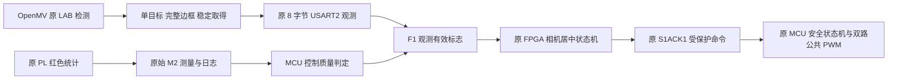

# C1 闭环观测质量候选

本轮只进行离线开发、真实 C/XSim 仿真与本地 OpenMV IDE 有限纯图像 RAM 核验。未生成/下载新 FPGA 位流，未擦写 MCU/相机 Flash，未发送真实运动命令。当前板上仍为只观测 FPGA 和原 v15 应用；新增候选没有部署。

## 先分清测量有效与闭环可用

red_frame_stats 的 target_valid 表示完整帧内至少存在一个红像素；它统计所有红像素的合并质心与 bbox，不是连通区域选择或跨相机物体身份。保留这个原始测量契约及全部输出，不能为了消除显示跳变而丢掉日志。

原始 M2 仍可合法表示 count=1 或边缘坐标 (0,0)。新增质量检查只收紧 F1 的“可用于闭环”有效标志，不改造测量协议，也不把原始像素数据当运动命令。

## OpenMV 候选

[red_target_policy.py](../src/prototype/skystar_openmv/red_target_policy.py)由生产候选、离线测试、真实 C/XSim 夹具以及 RAM 图像诊断共用，没有复制另一套选择算法。

- 原 LAB、8/8 像素/面积门槛及最小 blob 面积 20 均保留。
- 有两个或更多达到原面积门槛的红色候选时返回 AMBIGUOUS，不再因“最大”就假定它是指定物体。
- bbox 必须完整保留在图像内，留一像素边界；贴边返回 EDGE。几何不一致返回 GEOMETRY。
- 连续三帧合格后返回 VALID；丢失或无效后重新计数。没有平滑、插值或假造目标坐标。
- 无效仍发送原协议 dx=0、dy=0、flag=0；有效中心目标可发送 dx=0、dy=0、flag=1，含义不同。
- 每个相机单独创建 policy 实例；不共享三套云台的控制或 PID 上下文。

重新取得有效观测不等于重新授权。FPGA 运行中遇无效 F1 会锁定 loop fault 并请求 STOP；之后图像恢复仍不能自动重新使能。

生产 main.py 候选现依赖同目录 red_target_policy.py。以后如获准持久部署，必须备份并同时安装两者，不能只覆盖 main.py。本轮的[诊断生成器](../tools/build_openmv_quality_diagnostic.py)把真实 policy 源码嵌入有限 RAM 脚本，不依赖相机新增文件，且不创建 UART、PWM 或文件写入。

## STM32 控制质量

[c1_quality.h](../src/prototype/skystar_openmv/stm32_skystar_tracking/User/c1_quality.h)对已解码测量返回原因码：

| 码 | 含义 |
| --- | --- |
| 0 | 本候选控制质量可用 |
| 1 | 原帧不完整或原目标无效 |
| 2 | 红像素少于候选门槛 32 |
| 3 | 原始合并 bbox 触及画面边缘 |
| 4 | 几何不一致 |

32 是明确的候选控制质量门槛，**不是实测机械限位、通用识别阈值或经标定的最小物体尺寸**。该函数不修改原 M2 数据，不更新目标脉宽、不使能、不续租、不直接操作 PWM；它使 F1 无效，由原 FPGA 状态机发起 STOP，MCU 独立 500ms 租约仍保留。

原因码当前是 C 函数/离线记录，不是新增线上字段。单靠现有 F1 的无效位，不能在 PC 上区分贴边、歧义或丢失；精确原因的实机日志扩展仍待版本化设计。

在旧 70 秒采集的 640 个样本上离线回放实际 C 代码，638 可用、1 原始无效、1 count=3 的稀疏样本被拒绝。只挡住少数明确异常，不能据此声称所有跳变已消失。合并红区仍不能分离多个物体，上游 OpenMV 8 字节协议仍没有 CRC/配置 ID。

## 配置与标定

仓库默认 LAB=(32,43,13,51,4,52)，先前现场 RAM 使用 (10,80,20,90,-10,80)。同帧比较中可见前者 (-2,21)、后者 (1,31) 的有效偏差，且前者还出现 WARMUP；后者框住完整红圆。这是有限场景观测，不是整段统计或宽阈值的通用准确率证明。

本轮不静默改变仓库默认阈值。后续必须固定相机源码指纹、LAB 配置、分辨率、曝光/增益、安装方向，再采集标定数据；当前实际翻转 getter 结果未记录，仍为 UNKNOWN。8 字节帧不携带配置指纹，不能声称 FPGA 自动验证了相机配置。

当前阶段只需处理“同一纸靶已在两机视野内”的单云台相机居中；不用先实现三套同时运行或完整三维定位。机械正方向和小步响应仍需以后单独授权的实测，不能由纸靶平移推导。跨复位 epoch 供应、全 QID 路径接入及原板级 CDC/I/O 缺口没有在本轮解除。

实测与复现命令见[实验报告](../report/experiments/2026-11-02-c1-vision-qualification.md)。
