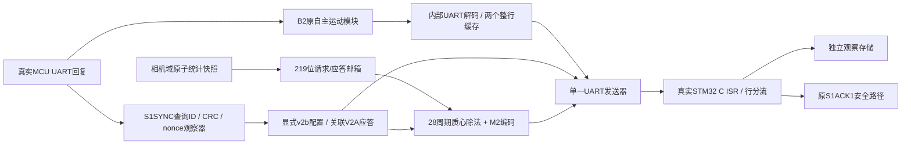

# C1 视觉 CDC、共享 UART 与测量会话

本轮在 `aab153143271b381d260c1e8a93590622fc50c15` 上继续，未修改 B2 `zynq_motion_s1.v`、UART 核心、safety.c、board.c、PID、OpenMV 脚本或三设备上下文。新增顶层 `zynq_vision_link` 是离线候选，尚无板级引脚分配。原 [C1测量格式](c1_three_gimbal_vision.md) 的 M2 字段保持不变。

## 实际数据流



内部 UART 回收不是新增物理串口；外部 MCU_TX 只由一个 serializer 驱动。PC 模式沿用原透传所有权与静默确认约束。采用整行缓存而非修改 B2 发送状态机，因此 B2 不知道的额外排队延迟必须计入 ACK 预算。

## CDC 接口与证明边界

`camera_snapshot[218:0]` 顺序：mask8、width16、height16、frame32、capture_tick32、complete1、target1、count19、sum_x28、sum_y28、xmin10、ymin9、xmax10、ymax9。字段可从既有 red_frame_stats 输出加相机域元数据原子打包，`camera_strobe` 必须是相机域单周期脉冲；不是逐位同步任意变化的总线。frame/tick 由相机域生产者提供，不是 PC 计算的目标。

邮箱 source holding 在请求接受后保持不变，直至 destination 消费并返回 toggle ACK；request/ack 各两级 ASYNC_REG，始终采样，不用业务使能门控同步链。消费者反压时保持 dst_valid/data。邮箱忙时丢弃新快照并计数，不覆盖在途数据。任意一域复位都会异步清空两端邮箱，再分别同步释放；系统集成必须真实连接此双域 reset 合约。相机复位清除 FPGA 测量配置状态，必须显式重配，不能复用复位前的授权推断。

`build/c1_cdc_constraints.tcl` 是可执行的层次化约束过程，不是伪造板级XDC：payload 设置 max_delay/datapath_only 与 bus_skew，toggle只切第一级同步器D，绝不对两个时钟整体 false-path。候选时钟10/14ns用于离线验证。布线后仍须复核payload时延、同步器布局、复位树及MTBF。

Vivado 会对219位 bundled-data 通道报告 CDC-15；这需要结合握手保持不变量、反压/双域复位测试和时延约束人工审查，不能将警告静默豁免成“CDC全部通过”。没有声称 RTL 仿真模拟了模拟亚稳态。

## 共享 TX 调度

- 优先级：完整控制行 > 配置行 > 测量行。控制正在形成、STOP、故障、PC交接期间禁止开始新测量行。
- 已开始行必须发送完整 LF 和停止位，正常优先级切换不截字节；STOP 最多等待已经发送的测量行剩余时间，然后按 B2 自身规则完成当前控制行后停止。
- 控制有两个最多64字节的缓存银行：前一命令排出时仍可接收STOP。第三条未消费行、格式错误或20ms未完成行会锁定传输故障，不丢弃部分内容后偷偷拼接下一行。
- 调度器每行最多128字节，20ms超时；故障时完成当前已接受字节，之后保持空闲高电平，锁定至显式复位。MCU仍独立执行500ms租约停机，不能把外层队列故障等同停止ACK。
- PC交接必须等内部队列、配置、测量和物理发送全部排空，以及 B2 获得停止确认；交接请求也触发 B2 STOP。已经排队但尚未开始的测量可被清除，避免交接死锁。
- 复位可中断字节并强制TX高，接收方需要按原协议处理错误/过期；不宣称复位中的半帧是有效命令。

115200/8N1 下，112字节测量行9.722ms，64字节控制上限5.556ms；新的存储转发另增加内部收完整行的时间。原 ACK_MS=100、HEARTBEAT_MS=100、TX_MS=10、MCU租约500ms未改；测试覆盖心跳与测量共存、STOP在测量中/控制行排出中的情形。20ms调度超时是新增传输队列上界，不是放宽原B2内部TX时限。

编码器改为两个并行28周期恢复除法，随后52周期CRC准备，避免组合变量除法形成长路径；输出仍为同样112字节与相同floor质心。测量丢弃计数目前随编码器控制flush复位，仅表示当前传输窗口，不可当持久累计丢帧统计；接收端帧号跳变统计保持原逻辑。

## 测量会话配置协议

只配置 camera0，camera1 OpenMV链路及未来camera2/3不共享此配置。所有十六进制小写，精确长度，LF结尾。

```text
v2b <MCU_nonce_16hex> <logging_session_16hex>*<crc16_4hex>\n
V2A <MCU_nonce_16hex> <logging_session_16hex>*<crc16_4hex>\n
```

每行43字节；CRC16-CCITT-FALSE覆盖星号前37字节，算法与M2/S1一致。V2A仅表示观察会话配置被接受，不是运动ACK、PWM确认或位置反馈；拒绝不发送V2A，FPGA等待200ms后保持未配置，并给出模块fault。没有自动重试或arm。

FPGA顺序：复位无流量 → 显式query → B2校验S1SYNC并进入AUTH → 独立只读观察器校验**相同查询epoch、S1ACK1能力、完整回复CRC**并提取nonce → 人工configure(session) → 发送v2b → 匹配V2A的nonce/session/CRC → active → 允许测量。LF、周期状态、CRC错误、其他nonce、旧session的应答都不能激活。

`config_nonce` 是可选交叉核对输入；0表示不提供，真正发送值始终来自UART观察器，不是FPGA猜测或自行生成。`config_session` 非零，由日志控制面明确分配；在同一MCU nonce内只允许递增，新session清除帧历史，同session重试幂等、不能重置已见帧序号。这个64位日志ID不替代B2的128位跨复位epoch，也不提供密码学认证。

MCU只有 SAFE_STOPPED、outputs=0、nonce匹配、CRC正确、消息未过期时配置；armed/manual/auto/fault均拒绝。发送队列无ACK空间时不安装配置。MCU复位默认未绑定；STOP等导致nonce变化时，原绑定和观察数据失效。心跳和任何测量都不改变这一规则。session配置没有使能PWM、续租或清故障的调用路径。

跨重启日志控制面必须分配新的session，持久化分配器本轮未实现；重复使用旧日志ID重新绑定后不能声称M2能辨认同ID的全部历史重放。原始CRC/session只用于记录关联与传输校验，没有赋予测量数据运动授权。

B2显式authorize与运动仍独立，测量配置成功不会自动arm。控制面应等待配置确认再请求运动，若抢先授权造成配置被拒绝，结果只能是未配置，不允许绕过安全状态。

## 离线复现

```text
python tools/check_c1_link.py --stage <new ASCII output directory>
python tools/check_c1_session.py --stage <same built directory>
python tools/check_s1ack_c.py --stage <same built directory>
python tools/check_c1_transport.py --stage <another new directory>
python tools/check_c1.py --stage <another new directory>
python tools/check_repository.py
python -m unittest discover -s tests -v
```

`check_c1_link`复用B2 XSI DLL桥，每1µs推进实际XSim，在逐位UART停止位采样后调用实际USART3 ISR/解析/安全/PWM寄存器模型；C响应再逐位送回FPGA。相机时钟与系统时钟异步，测试只从输入端口驱动，无force内部状态，也不预绑定MCU测量session。C故障测试与独立Testbench分开统计，不用软件模型替代RTL收发证据。

仍未上板：真实时钟、完整引脚、CDC物理实现、B2 epoch提供者、J23电压、实际Flash版本、相机元数据源接入、额外两套云台接口均需后续证据。配置/操作输入当前为同步控制总线，不是假设已经接了按钮或PS寄存器。所有实机动作必须另行授权。
