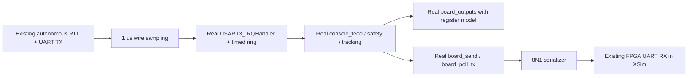

# B2-0 XSim / real STM32 C synchronous bridge

Status: **simulated diagnostic bridge**. S1ACK1, motion RTL and full B2 matrix remain planned.
The approved B1 design is unchanged. This checkpoint replaces its proposed Tcl socket
transport with Vivado 2024.2's documented XSI interface, after testing both approaches.

## Actual path



The C DLL includes unchanged board.c and main.c and links unchanged safety.c,
tracking.c and pid.c. Test exports invoke the actual private parser; Python does
not synthesize replies. The foreground wrapper follows main's polling order and
batch limits. A fixed RNG fixture produces nonce 1234000112340002, not hardware entropy.

XSim is elaborated with `xelab -debug all -dll`. Python loads the generated
xsimk.dll and installed xv_simulator_kernel.dll through ctypes, using installed
xsi.h declarations. Only top-level testbench RX input is driven. DUT state is never
forced. A 1 us step advances the actual 100 MHz RTL simulation; 100 MHz is a test
parameter, not a measured board clock. MCU SysTick advances every 1 ms. UART bit
period is 8680 ns (868 simulated FPGA clocks), 115200 nominal, LSB-first 8N1.

## Reproduce on the configured Windows host

From the repository, use Python 3.12 (without optimization, since assertions are
acceptance checks):

```powershell
D:\Python312\python.exe -B tools/check_uart_c_cosim.py --stage R:/evidence/b2-0/new-run
```

R: must already refer to the task output directory; choose a fresh ASCII stage
outside the repository. Tool paths currently target D:/Vivado/Vivado/2024.2 and
D:/Dev-Cpp/MinGW64/bin/gcc.exe. Missing tools cause failure, not a skipped PASS.
The runner compiles the DLL with warnings as errors, runs xvlog and xelab, then
executes XSim synchronously. It emits result.json, decoded-byte trace.json and
compiler/elaboration logs. See [actual result](../report/evidence/b2_0_uart_cosim/result.json).

## Assertions and limits

- Exact FPGA stream is st CR LF followed by stop CR LF; no movement commands.
- Every C TX byte must match the actual FPGA RX byte stream in order.
- Require boot banner, status nonce, boot and stop reasons, and complete CRLF.
- Every step checks stopped guardian, CCER=0, CCR1=CCR2=1500 and PWM pins in
  output mode. No physical voltage, pulse or mechanical state is inferred.
- Unknown X/Z, FPGA RX frame errors, watchdog/deadline, missing/reordered bytes,
  compiler failure or assertion failure fail the run.
- Diagnostic done counts LF completion only. It is explicitly **not a correlated ACK**.

The model serializes IRQ and foreground calls; it does not yet model interrupt
masking races, instruction timing, USART TXE pipelining, TIM4 preload/shadow timing
or analog electrical behavior. The stream trace contains decoded bytes, not a
full waveform capture. No S1ACK1 response parser, motion generator, lease-loss
scenario or full 29-case B2 acceptance is claimed by this test.

Next implement the approved response extension and its C tests, then FPGA
session/ACK matching, and only then the coupled motion/fault matrix. Preserve
both-channel PWM enable semantics and explicit operator authorization.

## Primary interface references

- [AMD 2024.2: preparing the design shared library](https://docs.amd.com/r/2024.2-English/ug900-vivado-logic-simulation/Preparing-the-Design-Shared-Library)
- [AMD 2024.2: dynamic linking XSI functions](https://docs.amd.com/r/2024.2-English/ug900-vivado-logic-simulation/Preparing-the-XSI-Functions-for-Dynamic-Linking)
