# B2 end-to-end offline acceptance plan (not executed)

Status: **PLANNED**. Depends on explicit approval of the
[B1 protocol](zynq_skystar_motion_protocol_v1.md). No B2 adapters, new RTL or MCU
extension have been implemented. Existing independent tests are baseline evidence,
not results of the coupled tests below. No serial, SWD, JTAG, GPIO or USB device API.

## 1. Real code integration, not two separate PASS messages

```mermaid
flowchart LR
  Sim[XSim candidate FPGA FSM + real TX] --> Bits[Timestamped TX wire bits]
  Bits --> USART[Independent USART serial peripheral model]
  USART --> IRQ[Actual USART3_IRQHandler]
  IRQ --> Queue[Actual board timed RX queue]
  Queue --> Main[Actual main console_feed and poll_safety]
  Main --> Safe[Actual safety.c and tracking.c]
  Safe --> PWM[Actual board_outputs + fake TIM4/GPIO registers]
  PWM --> Ack[Proposed response hook in actual candidate main]
  Ack --> Ring[Actual board_send / TX ring / board_poll_tx]
  Ring --> Serializer[USART TX shift-register model]
  Serializer --> Rx[Real FPGA UART RX and proposed ACK matcher]
  Rx --> Sim
```

Reuse `tests/host_checks.c`: address-backed register map, `BOARD_HOST_TEST`,
including real board.c, and `#define main firmware_entry` around real main.c.
Link real tracking.c, safety.c and PID sources as the current runner does.
Private main functions remain accessible within the test translation unit;
do not reimplement safety_command in Python or replace it with canned responses.
Compile two isolated host libraries: exact original v15 and proposed ACK candidate.
Do not edit production sources merely to expose test entry points; use test-only
wrapper exports. Keep frozen tests and expectations intact.

Proposed orchestration: persistent Python coordinator + host C shared library
(ctypes, matching 64-bit GCC ABI) + XSim batch Tcl socket bridge. The socket is
localhost software IPC, never a board network connection. XSim Tcl advances the
real RTL in bounded increments, samples TX, and drives only testbench RX/control
registers; never force DUT internal state or skip UART serialization. A first B2
spike must prove Tcl stepping/get_value/stimulus control and deterministic IPC
work in Vivado 2024.2 before claiming the architecture executable. No unverified
DPI/VPI feature is assumed. If the bridge is unavailable, report a blocker rather
than substitute independent tests as an end-to-end pass.

Initial grid <=1 us at 115200 plus exact 1 ms SysTick events; independent UART
decoder qualifies start, samples data centers and stop. Drive MCU SR RXNE/FE/ORE
and DR, call actual USART3_IRQHandler, then clear peripheral flags with modeled
read semantics. Schedule actual main-loop body order, max32 console/max64 vision
bytes per iteration, poll_safety before/after, tracking_tick, board_outputs,
periodic100ms status and board_poll_tx. MCU main scheduling delay is configurable.
Actual production initialization is executed with modeled HSI/PLL/RNG ready flags.
Fixed test RNG is an explicit fixture, not physical entropy proof.

For MCU transmit, model TXE availability and hardware shift-register duration.
Observe a real board_poll_tx queue-tail advance and resulting UART DR write
(including repeated equal byte values), enqueue that byte in peripheral model,
serialize start/data/stop and feed real FPGA RX. Preserve finite 512-byte TX and
256-byte RX rings, competing telemetry and queue overflow. Never return ACK directly
from the Python oracle. RX timestamp is MCU receive time, not simulation send time.
SysTick continues even when the foreground stalls. Host IRQ masks require an event
scheduler that defers ISR delivery; the current fake __disable_irq no-op alone is
insufficient to test races. Record this model extension explicitly.

Fake TIM4 records PSC, ARR, CCR1/2 preload and active shadow at update events,
CCER, GPIO MODER/AF/BSRR. Assertions about registers/shadow are offline predictions,
not scope measurements. CCR writes and active shadow updates must be separate.
Keep the FPGA and MCU timebases independent for offset/drift tests. Use bounded
simulation and wall-clock deadlines; performance tune batching only while retaining
every UART edge/sample, IRQ ordering and deadline event. Target each case <=2 s
simulated and <=120 s wall time after the interoperability spike; if infeasible,
record actual runtime and review harness architecture, not silently omit cases.

## 2. Exact oracle notation and evidence

All proposed wire formats below refer to B1, not existing functionality.

* `F(N,s,p)` is exact ASCII `s1 ` + lowercase16hex N + space + decimal s + space
  + payload p + `*` + four lowercase CRC16 hex + LF. CRLF variants are separate cases.
* `Q(q,p)` is proposed exact `s1q ` + lowercase32hex q + space + st/stop + CRC + LF.
* `Y(q,N,state)` is a CRC-valid S1SYNC with exact echoed q/capability/current N,
  expected state, target/mask/lastseq/txdrop fields.
* `A(N,s,p,result)` is S1ACK S with echoed pre-operation nonce, seq, opcode and
  CRC of **the actual request**, plus expected post-state/targets/registers.
* `Z(q)` is S1ACK Q for correlated stop, REG stage, mask0, GPIO low, current nonce.
* `OFF`: TIM4 CCER=0 and PD12/13 output-low GPIO; CCR values may retain old targets.
* `ON(P,T)`: CCER bits0/4 set (0x11), AF2 on PD12/13, CCR1=P/CCR2=T;
  active shadow changes at appropriate update event, period ARR19999/PSC15 at HSI16.

Before running any test, independent Python oracle materializes complete expected
bytes/hex/CRC into an immutable input manifest. Compare wire captures byte-for-byte;
do not reuse DUT CRC implementation as its own oracle. Check published existing
fixture `s1 1234567887654321 0 arm*be15\n` and standard CRC `123456789 -> 29b1`.
Variable MCU nonce comes from the explicitly recorded RNG fixture; software never
guesses an unknown real nonce. Correlation checks use the captured requests, not
testcase labels. Symbolic rows below are specifications, not fake captured logs.

Common PASS requires byte trace, full MCU permission/state trace, register writes,
FPGA transaction outcome, timing and no forbidden output all match. **Any mismatch,
unmatched ACK counted successful, unsolicited movement, unexpected renewal or
missing terminal assertion is FAIL.** Every test includes explicit failure below.

## 3. Required test matrix

Precondition for motion rows: fresh SYNC, explicit human-auth test input, accepted
arm, targets initially1500/1500. All operations below occur only in simulation.

| ID / input | Expected UART bytes | Expected STM32 state / PWM | Expected response and PASS condition | Explicit FAIL condition |
| --- | --- | --- | --- | --- |
| 01 query trigger while off | Q(q1,st), no S1 motion | stopped; OFF | Y(q1,N,stopped), CRC/fields exact | Query enables or renews |
| 02 nonce discovery with stale/foreign/corrupt status injected | Q(q2,st); only matching Y accepted | unchanged; OFF | q2/capability/CRC checked, N copied from valid response | Adopt P0 SESSION, fabricated N, stale q1 or invalid CRC |
| 03 correct arm after human authorization | F(N,0,arm) | armed; OFF | A ACCEPT REG/off; live_ms matches arrival | PWM enabled by arm or auto-arm without input |
| 04 PAN adjustment | F(N,1,pan 1550) | manual; ON(1550,1500) | A ACCEPT REG, PAN changed only as target | TILT target changes or mask interpreted as PAN-only |
| 05 TILT adjustment | F(N,2,tlt 1550) | manual; ON(1550,1550) after04 | A ACCEPT REG matching tlt | Sender emits tilt or PAN target changes |
| 06 individual homes, first PAN then TILT | F(N,3,pan 1500), F(N,4,tlt 1500), each after ACK | ON(1500,1550) then ON(1500,1500) | Two distinct accepted ACKs and intermediate register assertions | home substituted for single-axis command |
| 07 both home from nonhome targets | F(N,s,home) | manual; ON(1500,1500) | ACCEPT REG and both target changes | Home emitted automatically after reset/fault |
| 08 corrupted request CRC | Mutate one CRC nibble of F | fault/parse; OFF; nonce rotates on first fault | No fabricated valid correlated ACCEPT; bounded fault diagnostic, sender times out/faults | PWM stays permitted or heartbeat continues |
| 09 wrong nonce with correct CRC | F(Nold,s,pan 1550) | no target update, no renewal; existing lease eventually expires | REJECT session if identity parseable; current N returned separately | Auto-adopt N and retry movement |
| 10 exact duplicate | Repeat captured accepted F(N,s,p) | no renewal/target step; eventual OFF without fresh request | REJECT sequence; duplicate never considered new success | Duplicate extends live_ms |
| 11 sequence rollback | F(N,s-1,p), valid CRC | unchanged targets/lease, eventual expiry | REJECT sequence | Sequence decreases or lease renews |
| 12 ACK lost after accepted motion | Deliver F, drop only return A | initially ON, then fault/OFF at last accepted lease+500ms | FPGA deadline100ms -> no renewals, stop request may be delivered but not assumed successful | New-seq retry of motion or success inferred from periodic LF |
| 13 delayed ACK beyond deadline | Deliver A after100ms local deadline | no fresh authorization; OFF after stop/expiry | Late A ignored, cannot resume | Late A re-enables heartbeat/command flow |
| 14 disconnect >500ms | Suppress all link bits after accepted command | at499ms permit; at500ms SysTick forces OFF independently of foreground | first fault retained; FPGA timeout; no success receipt required | Output remains enabled past modeled deadline event |
| 15 MCU reboot | Reset model, fresh RNG fixture N2; replay old F | boot stopped/OFF; old N rejected | New sync and new human authorization required | Cross-boot replay accepted |
| 16 FPGA reboot while MCU active | Assert reset midbyte and while WAIT_ACK | MCU expires or partial-input faults, OFF | No arm/home/pan/tlt/hb emitted after release | Prior motion/authorization replayed |
| 17 locked fault | Inject valid old/new motion and periodic vision after fault | fault/OFF until explicit valid new arm | rejection/no auto recovery; first WHY preserved after stop/st | Any new output before authorization |
| 18 explicit recovery | fresh Q, manual auth, F(Nnew,0,arm), separate motion | fault -> armed/OFF -> manual/ON only on final step | Correct correlated ACK for each step | Discovery or arm alone creates PWM |
| 19 ownership switch | Request PC takeover during SEND/WAIT; then Q stop + quiet ack | finish transaction, then OFF before transfer | No truncated frame; transfer only after confirmed off and idle guard | Half-frame splice, two writers, transfer after unconfirmed stop |
| 20 reset combinations | Both resets; start high; bounced start; PC quiet/unquiet variants | boot/OFF | No unsolicited motion; no stale LF counted as ACK; no unsafe handoff | Any automatic arm/motion/hb |
| 21 correlated stop / bare stop | Q(q,stop); separately raw stop LF | stopped or retained fault; OFF; CCR may unchanged | Z(q) REG/off; bare stop produces no correlated success | Sent stop alone labeled stopped |
| 22 legal software boundaries | F at1300/1700 for each axis, isolated cases | matching targets; ON both under valid lease | Correct byte/target/mask results | Clamp instead of exact permitted target, other target altered |
| 23 illegal inputs | Valid CRC with1299/1701, fraction, tilt, empty, long line; bare pan/tlt/home/auto while armed | rejected/fault as actual parser dictates; OFF for format/range/bare-active failures | No accepted movement or lease extension | Old bare protocol bypasses guardian |
| 24 fresh heartbeat / duplicate heartbeat | F(N,s,hb), then duplicate | first renews once; armed/off stays OFF; duplicate not renew | Identity-matched ACCEPT then REJECT | hb enables armed outputs or duplicate renews |
| 25 original v15 compatibility negative | Q probe to unmodified v15 | no extension capability, no movement; possibly parse fault | FPGA diagnostic-only; no S1 arm/old bare fallback | Legacy FW15 treated as S1ACK1 |
| 26 TX queue/telemetry pressure | Maximum periodic traffic, stalled TXE, pending ACK and new command | bounded queue, proposed admission failure safe/OFF | No overwrite, truthful TX_DROP, sender timeout not success | Missing ACK replaced with fake immediate response |
| 27 partial/queued stale and UART errors | Truncate F >=200ms, delay queued bytes >=200ms, FE/ORE/overflow | fault/OFF; discard residual line through delimiter | Fault latched, clean fresh recovery only | Tail interpreted as new valid motion |
| 28 sequence exhaustion and pending-state races | seq ffffffff then wrap; ISR expiry between target write and snapshot | wrap rejected; race OFF/fault with truthful ACK | No accepted wrap; no REG/on snapshot after off event | Counter rollover or optimistic ACK |
| 29 freshness/reset epoch | Reinject old valid Y/A after FPGA reset with new qid | no authorization | Reject old qid; fail closed if fresh qid source unavailable | Constant repeated qid enables replay |

Use independent initializations for boundary/fault cases; keep per-case sequence
allocation explicit in input manifest. Include both UART directions at nominal
and +/-2% serial timing, reset at each bit position, split CR/LF, and consistent
operation ordering at exact deadline boundaries. Don't send software boundary
tests to hardware; no mechanical limit is inferred.

## 4. Deliverables and stage gates

1. B2-0: prove XSim/C lockstep handshake, timestamp ordering, serial decoder,
   register side effects and IRQ scheduling using existing diagnostic/no-motion
   inputs. Checkpoint result must include a real bidirectional trace.
2. B2-1: original v15 negative compatibility and all existing tests unchanged;
   then implement approved S1ACK1 extension in an isolated candidate. Unit-test
   formatter/decoder, bounds, CRC and queue behavior, never claim board support.
3. B2-2: implement FPGA protocol FSM/formatter/matcher using existing UART modules;
   no bitstream or hardware. Exercise full matrix with C in the same causal loop.
4. B2-3: fault injection/seeded regression, firmware cross-build/vector checks,
   RTL synthesis/OOC checks if authorized; hash actual source and tools, collect
   exit codes/PASS markers and explicit failures. Only then review B3 readiness.

Planned artifacts: per-test seed/timebase manifest, raw pin-bit UART trace, decoded
wire bytes, C state/nonce/lease trace, TIM4/GPIO write trace, ACK comparison, RTL
signals, commands/tool versions/SHA-256, actual exit codes and summary. Preserve
failures and rerun without relaxing assertions. All outputs under the task D-drive
directory, staging outside Git. Public evidence excludes photos, IDs, credentials,
vendor code and generated large caches. No passing numbers are prefilled in B1.

Blocked before real hardware: fresh qid source, measured board clock/J23 voltage,
new XDC/control pins, reset/CDC review, actual Flash identification, independent
servo power isolation and explicit operator approval. PWM-register model is not
an oscilloscope or a mechanical model. This plan ends before B2 implementation.
