# B2 S1ACK1 implementation and reproduction

Status: offline candidate; see the [acceptance report](../report/experiments/2026-10-31-b2-motion.md)
for actual results and remaining coverage. No bitstream or physical firmware update.
The [approved B1 design](zynq_skystar_motion_protocol_v1.md) is retained as a dated
proposal; this document records the implemented subset and integration contract.

## Actual data path

```mermaid
flowchart LR
  Operator[Synchronous operator strobes + fresh epoch] --> FSM[zynq_motion_s1]
  FSM --> TX[Existing uart_tx_8n1]
  TX --> Wire[XSim pin-bit / USART model]
  Wire --> ISR[Actual USART3_IRQHandler]
  ISR --> Main[Actual console_feed]
  Main --> S1[safety_command unchanged]
  S1 --> Targets[tracking_command unchanged]
  Targets --> Driver[board_outputs unchanged]
  Driver --> ACK[S1ACK1 register snapshot and CRC]
  ACK --> Queue[Actual board_send / board_poll_tx]
  Queue --> Serial[Modeled USART serializer]
  Serial --> RX[Existing uart_rx in XSim]
  RX --> Match[CRC + full transaction matcher]
  Match --> FSM
```



The XSI coordinator never fabricates normal MCU replies. It calls actual STM32
C ISR, queues, parser, guardian and driver with a host register model. Fault
injections are explicit in the runner: dropped, delayed, CRC-corrupted or
identity/target-modified return bytes. Mutated identity tests recompute response
CRC independently with Python binascii, so they exercise correlation, not just CRC.

## STM32 candidate

`S1ACK1` is compile-time opt-in. Default builds retain the v15 console behavior;
use `build.py --console-usart 3 --s1ack1 --output-root <fresh-D-output>` for the
unflashed extension. The label is FW15 plus capability S1ACK1, not a claim that
previously flashed FW15 supports ACKs. safety.c, safety.h, tracking.c and the
existing guard/driver permission rules are unchanged.

Implemented forms (CRC16-CCITT-FALSE before the star, LF; input also accepts CRLF):

```text
s1q <qid32hex> st*<crc4hex>
s1q <qid32hex> stop*<crc4hex>
s1 <MCU_nonce16hex> <sequence_decimal> arm|hb|pan P|tlt T|home*<crc4hex>
S1SYNC <qid> S1ACK1 <nonce> <safe> <why> <pan> <tlt> <mask> <lastseq> <txdrop>*<crc>
S1ACK S <request_nonce> <request_seq> <request_crc> <op> <result> <stage> <newnonce> <safe> <why> <reject> <pan> <tlt> <mask> <ccr1> <ccr2>*<crc>
S1ACK Q <qid> - - stop <result> <stage> <newnonce> <safe> <why> <reject> <pan> <tlt> <mask> <ccr1> <ccr2>*<crc>
```

The query namespace only dispatches st/stop. Malformed Q/S1 identity or CRC faults
closed and does not manufacture a correlated ACK. Parseable protected requests
still go through the existing safety_command. Rejected requests echo their
original identity; newnonce is a separate post-operation value. Raw legacy motion
cannot bypass safety. The existing MCU auto command remains guarded, but the new
FPGA formatter has no auto opcode.

After processing, the existing guard is polled and outputs applied; an
IRQ-protected board snapshot reads CCER, pin mode and CCR1/2. ACCEPT/REG means this
software-observed snapshot, not a waveform or achieved mechanical position.
ABORTED/NONE is emitted if an accepted S request no longer has a permit or the
requested outputs are absent at snapshot. REJECT/NONE includes the per-request
rejection reason. A later interrupt can of course change registers after a
snapshot; an ACK is not a persistent physical-safety guarantee.

At least 256 TX-ring bytes must be available before a correlated request is
admitted. Insufficient capacity faults off without applying a new target.
Formatting/enqueue failure also faults off. Candidate periodic telemetry is the
short S1STAT line (not both long P0V and S1STAT), admitted only with at least384
bytes free, retaining response room. This is an intentional candidate telemetry
change; legacy PID-workbench P0 output remains in default builds. TX ring size,
nonblocking transmission, 500ms guard and 200ms partial/stale timeout are retained.

## FPGA interface and state machine

The new module is independent of the original transparent/diagnostic RTL and XDC.
It reuses the existing byte TX and RX. CLOCK_HZ/BAUD and deadlines are parameters;
the tests use 100MHz and 115200, not a measured board oscillator.

Inputs query, authorize, command and stop_request are **synchronous, already
qualified operator strobes**, not raw asynchronous/debounced physical buttons.
Rising-edge capture rejects a held input; commands received while busy are not
queued. axis0 is PAN, axis1 TILT, axis2 both-home; pulse_us is ignored for home.
PAN/TILT values outside1300..1700 are rejected locally. Those are software bounds,
not measured mechanical limits. No command is emitted just by releasing reset.

| Encoded state | B1 semantic phase | Behavior |
| --- | --- | --- |
| IDLE(0) | IDLE | Wait fresh query; no boot traffic |
| SEND(1), op=query | QUERY_STATUS | Finite correlated Q st |
| WAIT_SYNC(2) | SESSION_SYNC | CRC/qid/capability/state/mask validated |
| AUTH(3) | WAIT_ARM_AUTH | Separate authorization triggers another query |
| SEND/WAIT_ACK, op=arm | ARMING | Same reviewed nonce/state/targets, seq0; require REG/off |
| READY(4) | ARMED | Await separate movement input or due heartbeat |
| SEND/WAIT_ACK, op=pan/tlt/home | SEND_COMMAND/WAIT_ACK | One outstanding identity and exact expected targets |
| SEND/WAIT_ACK, op=hb | HEARTBEAT | New sequence, no output enable from armed/off |
| SEND/WAIT_ACK, op=stop | STOPPING | Cancel authorization; require correlated REG/mask0 |
| FAULT(6) | FAULT | No renewal or replay; fresh query plus new authorization needed |

WAIT_ACK is encoded5. A reset forgets permission and pending transactions.
Heartbeat deadline is measured from the previous request's final transmitted
byte; nominal100ms. ACK deadline is an absolute100ms after final stop bit;
periodic telemetry cannot extend it. Authorization defaults to30000ms from the
explicit authorization edge and cannot be extended by ACKs/telemetry. The expiry
regression uses the same parameterized path with300ms, explicitly not a real-time
30-second hardware measurement. SEND has a10ms serialization watchdog; an abort
waits for a byte boundary and the MCU independently ages an incomplete line.

A movement ACK must match nonce, sequence, request CRC and opcode, have valid
response CRC, ACCEPT/REG and the expected software targets/mask/CCR values.
CRC-valid ACKs with foreign identities are ignored until the absolute deadline;
a matching rejection or wrong target faults. A late ACK in FAULT cannot resume
heartbeats. No new-sequence retry is used to guess whether a movement executed.
`pan_target`, `tilt_target`, `pwm_mask` are the **last accepted MCU snapshot**;
`stop_confirmed` is correlated register-off evidence, not removal of servo power.

A PAN command preserves TILT target and vice versa, but either movement enables
**both** channels. arm alone and an armed/off heartbeat keep both off.

## Ownership and reset freshness contract

A 12-bit UART-idle guard plus pc_quiet_ack grants local ownership. PC takeover
requests cancel authorization and send stop; transfer waits for confirmed off,
no transaction and idle guard. An unconfirmed stop retains local ownership.
The host must actually remain quiet; no mux can prevent an uncoordinated PC writer.
Reset clamps TX high but may terminate a current frame; after release PC must
remain quiet and explicit discovery/authorization is required.

The 128-bit epoch input is supplied by the future integration. It must never reuse
an earlier qid, including internally incremented recheck/stop IDs, across resets.
Simulation uses deterministic distinct fixtures. This is NOT a hardware freshness
source and must be solved before any hardware motion integration. No autonomous
nonce is invented: the MCU nonce comes only from a matched S1SYNC.

## Reproduce

Use Python3.12 without -O, Vivado2024.2 and the configured MinGW64 compiler:

```powershell
D:\Python312\python.exe -B tools/run_motion_acceptance.py --stage R:/evidence/b2-motion/new-suite
```

The stage must be new, ASCII and outside the repository. R: is the existing alias
for the user-specified D-drive task directory. The suite compiles the real C and
XSim libraries, runs isolated processes, saves individual input manifests,
responses/state traces/logs and exit codes, and fails on any assertion or nonzero
exit. `tools/capture_motion_trace.py` can repeat a normal case while recording
wire transitions at1us resolution. No COM-port/JTAG/SWD/device library is used.

The transmitter prefetches each formatted byte into `tx_latch` before asserting
valid. The independent functional-netlist smoke guards this interface against
RTL/synthesis behavior divergence; it checks 45 fixed query bytes and stop bits.

For structural implementation, copy the three RTL files and
`build/check_motion_s1.tcl` into a fresh staging directory and execute the Tcl
with Vivado batch. This uses an OOC candidate xc7z100ffg900-2/100MHz only, creates
no bitstream and does not assign physical pins. Read the actual timing report;
the structural PASS marker alone is not timing or board acceptance.

## Remaining model and hardware limits

The host executes C functions sequentially, not Cortex-M instructions. The
adapter does not model every PRIMASK/preemption interleaving or TIM4 active-shadow
update; CCR/CCER/pin-mode tests are register evidence only. The wider B1 matrix's
all-bit reset sweep, +/-2% baud sweep, exhaustive IRQ races and physical waveform
checks are not implied by the named scenarios. Neither a software target nor a
register readback measures servo angle.

Actual input clock, reset synchronization/button conditioning, epoch source,
new control pins/XDC, J23 voltage, current physical Flash identity, power cutoff
and measured PWM remain unverified. Existing J23/USART3/PD12/PD13 constraints are
preserved; no physical device has been programmed or operated by this work.
