# B1: FPGA / SkyStar motion protocol design v1

Status: **PLANNED, not implemented**. Baseline source commit
`82fa26312656c2c9ebb36290ca20c778f12fd040`. This document authorizes no B2 work,
firmware changes, RTL motion generator, bitstream, hardware or motion operation.
Source fingerprints: [review inventory](../report/evidence/b1_motion_design/source-review.json).

## 1. Architecture and compatibility decision

```mermaid
flowchart LR
  Human[Explicit operator authorization] --> FSM[Proposed FPGA motion FSM]
  FSM --> Enc[Proposed S1 formatter and CRC]
  Enc --> TX[Existing UART TX]
  TX --> Mux[Coordinated PC or FPGA ownership]
  Mux --> ISR[Actual USART3 ISR and timed queue]
  ISR --> Parse[main.c console_feed]
  Parse --> Safe[safety.c permission and lease]
  Safe --> Target[tracking.c pan_us and tilt_us]
  Target --> Driver[board.c output guard and TIM4]
  Driver --> Snap[Proposed correlated response snapshot]
  Snap --> RX[Existing FPGA UART RX]
  RX --> Check[Proposed CRC and transaction matcher]
  Check --> FSM
```



**Existing:** FPGA ROM sends only st/stop. UART RX exposes bytes; an LF ends its
wait but is not an ACK. MCU main emits P0V and S1STAT both on commands and every
100 ms. No transactional response exists. M1 vision is only a separate proposal.

**Decision:** preserve every existing S1 movement validation rule. Propose a
small response/diagnostic-envelope extension, called capability `S1ACK1`, to a
future v15-derived candidate. Do not call this capability part of original v15.
Original v15 remains readable in diagnostic mode, but cannot satisfy the reliable
motion-ACK contract: fail closed, never fall back to bare motion or LF-as-ACK.
No new source code is implemented by B1.

## 2. Field-by-field source audit

| Field/rule | Classification | Actual implementation / sender requirement |
| --- | --- | --- |
| UART | Existing | 115200, 8N1; board.c USART3 selected by CONSOLE_USART=3 |
| Request | Existing | `s1 <nonce> <seq> <payload>*<crc>\n`; main also accepts CRLF |
| nonce | Existing | Exactly 16 hex characters, high 32-bit word then low; MCU owns it; parser accepts hex case; FPGA emits lowercase |
| CRC | Existing | safety_crc: CCITT-FALSE, polynomial 1021, init ffff, nonreflected, xorout 0000; covers exact ASCII before `*`, excludes CRC and CR/LF |
| sequence | Existing | Decimal uint32; arm uses 0; subsequent positive values strictly increase; no rollover/reuse within nonce |
| arm | Existing | Current nonce, seq 0, entropy valid, not already armed; grants lease with PWM OFF |
| pan / tlt | Existing | Integer pulse in 1300..1700 us; updates selected target; both channels become enabled when guard permits |
| hb | Existing | Fresh positive sequence renews lease without changing targets or enabling an armed-but-off controller |
| home | Existing | Both targets 1500 us and outputs requested ON |
| auto | Existing | Enters existing vision-dependent mode, initially off; excluded from B2 manual-motion sender whitelist |
| st / stop | Existing | Bare commands supported without nonce/CRC; st does not renew; stop closes session and disables output; first fault preserved |
| lease | Existing | 500 ms from UART receive timestamp; SysTick enforces independently of foreground |
| partial/stale | Existing | 200 ms inter-byte partial timeout or queued-byte age; discard through line terminator and fault/flush |
| fault recovery | Existing | Stop/fault rotates nonce when applicable; fresh explicit arm needed; traffic returning is insufficient |
| S1STAT | Existing | SAFE, WHY, NONCE, SEQ, TX_DROP, FW 15; no CRC, request ID or transaction ACK |
| P0 SESSION 1 | Existing | Legacy label, NOT safety nonce; never use to arm |
| S1ACK1 / S1Q / S1SYNC / S1ACK | Proposed addition | Formats below, absent from current firmware/RTL |
| Fresh client query ID source | Pending confirmation | Must not repeat across FPGA resets; source of reset-persistent epoch or qualified entropy not yet selected |

Golden existing CRC fixture: `s1 1234567887654321 0 arm*be15\n`.
Unknown/old nonce and duplicate/reversed sequence do not renew lease. CRC errors
trip even from unarmed states; a bare motion request while armed faults. Invalid
format/range after valid session checking faults. Verify the exact source order,
not an assumption that every reject has the same effect.

Authoritative call chain: main.c console_feed -> safety_command ->
tracking_command; main loop -> poll_safety -> board_outputs. The legacy raw
tracking_command function is NOT a public bypass: v15 main routes requests through
safety first, and the driver separately gates output. An FPGA sender whitelist
must allow only S1 arm/hb/pan/tlt/home and bare stop/st; exclude bare movement and
auto for the first implementation. No PC writer may concurrently own the link.

## 3. Nonce discovery and minimum response extension

### Existing diagnostic mode

Parse complete S1STAT lines, bounded length and exact numeric fields. `st` can
obtain a candidate MCU nonce; do not invent it on FPGA or use FPGA query ID as
nonce. However, original S1STAT lacks integrity and correlation: it is diagnostic
evidence only, not sufficient authorization for the proposed reliable sender.

### Proposed S1ACK1 discovery

All formats in this subsection are **proposed additions**, not accepted by v15.
Use the existing CRC16 algorithm for each entire ASCII prefix before `*`.
Canonical single spaces, LF terminator (receiver accepts CRLF), unsigned decimal
values, lowercase fixed-width hex. Bound every proposed line to 256 bytes including
terminator; parse into temporary storage and commit only after length/CRC checks.

```text
s1q <qid:32hex> st*<crc:4hex>\n
s1q <qid:32hex> stop*<crc:4hex>\n
S1SYNC <qid> S1ACK1 <nonce:16hex> <safe> <why> <pan> <tlt> <mask> <lastseq> <txdrop>*<crc>\n
S1ACK Q <qid> - - stop <result> <stage> <newnonce> <safe> <why> <reject> <pan> <tlt> <mask> <ccr1> <ccr2>*<crc>\n
S1ACK S <reqnonce> <reqseq> <reqcrc> <op> <result> <stage> <newnonce> <safe> <why> <reject> <pan> <tlt> <mask> <ccr1> <ccr2>*<crc>\n
```

Q requests are ONLY st/stop; never arm, heartbeat or motion. Valid Q st returns
S1SYNC; valid Q stop calls the existing stop path, then returns S1ACK Q. Preserve
bare stop as an unconditional emergency request with no fabricated correlation.
Malformed Q is bounded/discarded and must not renew a lease or enable PWM; exact
parser fault policy is a B2 review item. Integrate dispatch before the existing S1
call only for this explicit non-motion namespace, never a generic payload bypass.

qid is a proposed 128-bit freshness token, distinct from MCU nonce. B2 uses
deterministic distinct epochs to test matching, not as proof of real entropy.
Do not enable hardware motion until cross-reset qid freshness is resolved. Flush
local stale RX/parser state and require a fresh echoed qid. Exact capability,
nonce, valid CRC, complete line, allowed states and deadline must all match.
CRC detects transmission corruption, not malicious replay/authentication. Discovery
of legacy FW15 alone is not capability proof. Lack of S1ACK1 means diagnostic-only.

### Proposed motion ACK matching and meaning

Keep the existing S1 movement wire format unchanged. Snapshot request nonce,
sequence, opcode and request CRC BEFORE invoking safety_command (stop/fault may
rotate current nonce). Only one request outstanding, including heartbeat.
Match all four fields to the retained request. No sequence reuse means the CRC is
an extra consistency check, not the sole identity. A stale/unmatched ACK is ignored
and cannot renew FPGA trust or authorize the next request. Invalid ACK CRC fails
the transaction. If request identity cannot be safely parsed (bad framing/CRC),
do not invent a correlated ACK: send only bounded fault diagnostics; sender times
out and stops. Safe parsing of a rejected request identity must never execute it.

`result`: ACCEPT, REJECT, or ABORTED (validated request superseded by guard failure).
`stage`: VALIDATED, TARGET, REG, or NONE, explicitly distinguishing evidence:

| Evidence | Meaning / limitation |
| --- | --- |
| A received | UART complete frame only; not acceptance |
| B VALIDATED | safety_command accepted request; cannot claim resulting hardware state |
| C TARGET | software pan_us/tilt_us updated |
| D REG | after guard/output application, CCR/CCER and GPIO mode snapshot; mask bit0 PAN, bit1 TILT derived from actual register/model state |
| E waveform | NOT representable as proven by this ACK; needs external waveform measurement |
| F position | NOT representable as proven by this ACK; needs independent position measurement |

REG is software-observed register state, not effective PWM pulse proof. TIM4 CCR
preload means a written CCR need not already be active on the pin. Stop may leave
CCR values unchanged while CCER is zero and GPIO low. `why` is first latched safety
cause; `reject` is this request rejection reason, which must be reset/assigned per
transaction rather than copied from unrelated old diagnostics. `newnonce` is the
post-operation current MCU nonce; never substitute it for echoed reqnonce.

Minimal future hook: main retains pending request metadata; run existing guardian,
then existing board_outputs; take a short, consistent IRQ-protected snapshot;
format/enqueue response outside the critical section. If ISR trips between stages,
return current off/fault state, not optimistic ACCEPT/REG-on. No modifications to
tracking PID, permission predicates or lease thresholds are needed. This hook is
proposed and requires B2 tests; current status() runs before final board_outputs,
so its current output is NOT already such a REG acknowledgment.

Existing TX ring is 512 bytes and status formatting competes with it. Proposed
ACK max 256 bytes, reserved capacity/priority ahead of periodic telemetry, bounded
pending slot and TX_DROP accounting. Do not block ISR/foreground waiting for TX.
Do not silently overwrite queued responses. Queue exhaustion: refuse new movement
admission or force stop, then sender relies on timeout; the detailed small admission
hook and telemetry scheduling must be reviewed before implementation. At 115200,
256 bytes take 22.23 ms; periodic P0/S1STAT load and full ring must be in tests.

## 4. Axis semantics (preserve existing behavior)

| Intent | Existing S1 payload | Proposed FPGA behavior |
| --- | --- | --- |
| PAN only | pan P | Change PAN target, retain TILT target; require operator awareness BOTH PWM channels enable |
| TILT only | tlt T | Change TILT target, retain PAN target; same dual-enable rule |
| PAN software home | pan 1500 | Not a mechanical zero claim |
| TILT software home | tlt 1500 | Not a mechanical zero claim |
| Both software home | home | Both targets 1500, enables both outputs; never use for automatic reset/recovery |
| Stop all | stop or proposed correlated Q stop | Both off, no physical power-cut claim |
| Link loss | No new heartbeat | MCU faults at lease expiry; FPGA stops renewals and enters FAULT |
| Recovery | Fresh sync, human arm, fresh explicit motion | No automatic replay or restoring prior target motion |

Per-axis enable is NOT supported. A future mask command would require versioned
permission/driver/state semantics, deciding what an unpowered axis does under
load and how stop overrides both. Do not implement it as part of an ACK patch.
Existing 1300..1700 is only a software window; 1500 is only software reference.

## 5. Proposed complete FPGA state machine

No state below is implemented by current diagnostic RTL. Only RESET initializes
without transmitting. Explicit diagnostic trigger enters QUERY_STATUS; motion
authorization is a separate fresh human action, not the diagnostic start button.

| State | Entry/action and exit | Deadline/failure |
| --- | --- | --- |
| RESET | TX idle; forget authorization, pending request/nonce/seq; PC quiet across reset | No autonomous arm/home/motion/hb; reset may truncate a serial frame |
| IDLE | Wait explicit diagnostic start and acknowledged ownership | No transmission from power-on alone |
| QUERY_STATUS | Send Q st with fresh qid | 100 ms response budget after final stop bit; failure -> FAULT/diagnostic-only |
| SESSION_SYNC | Validate S1SYNC CRC/qid/capability/state/nonce; require mask0 and stopped/fault | Active MCU -> STOPPING first; unknown fields -> FAULT |
| WAIT_ARM_AUTH | Store candidate session; PWM stays off | Human confirmation triggers fresh query, then ARMING only if same reviewed state/nonce; changed session requires new authorization |
| ARMING | S1 current nonce, seq0 arm | Matching REG/off + armed ACK within 100 ms -> ARMED; else STOPPING/FAULT |
| ARMED | No motion without separate explicit axis/value request; bounded operator enable duration | Heartbeats only while explicit authorization remains valid; no unattended indefinite authorization |
| SEND_COMMAND | Allocate fresh seq once, latch payload, send finite S1 | TX stall/framing issue -> FAULT; finish bounded command or reset-abort, never splice |
| WAIT_ACK | Match complete ACK identity/CRC/result and target/expected register state | 100 ms absolute deadline; unrelated traffic does not extend; no blind retransmission |
| HEARTBEAT | Fresh seq hb at nominal 100 ms from prior request; one outstanding request | ACK required; return to authorized state; missed/late ACK stops all renewals |
| STOPPING | Cancel renewals and queued movements; send correlated Q stop when TX available; bare stop fallback is request only | Matching REG/mask0 provides register-level evidence; absent ACK -> stop unconfirmed, FAULT; do not report safe physical state |
| FAULT | Clear authorization and pending movement; remain nonmoving; permit manual diagnostic/stop only | New operator recovery -> fresh QUERY_STATUS; never auto-arm |

Timing targets are **proposed, to verify**: heartbeat 100 ms, ACK 100 ms,
local bounded command serialization <=10 ms, FIFO/parser budget sufficient for
maximum accepted lines. The immutable MCU lease stays 500 ms; MCU partial timeout
stays 200 ms. No heartbeat may run in background after an ambiguous motion result.
Proposed operator authorization lifetime is 30 seconds maximum, measured locally
from explicit authorization; release/cancel or expiry enters STOPPING. It cannot
be extended by telemetry or ACKs; extension requires a new deliberate operator
action. QUERY/SYNC/ARMING never inherit an earlier expired authorization. This
FPGA policy adds no new MCU lease duration and remains subject to user approval.
Use a monotonic FPGA deadline from local send time, not subtraction of unsynchronized
MCU timestamps. Do not claim 500 ms from FPGA disconnect equals measured pin cutoff.

| Exception | Required behavior |
| --- | --- |
| Serial disconnect / bad stop bit / bad ACK CRC | No successful ACK; stop renewals, request stop if possible, latch fault |
| Request CRC error | MCU parse fault, off; identity may be untrusted; sender timeout is acceptable, false ACK is not |
| Duplicate or reversed sequence | Existing MCU rejects, does not renew; FPGA treats rejection as failed transaction |
| Old nonce | Reject without renewal; no automatic nonce adoption or re-arm |
| Lost/delayed ACK | Never retransmit movement or heartbeat with a new identity to guess success; late ACK cannot resurrect expired authorization |
| STM32 reboot | Fresh nonce/off; old session rejected; rediscovery and human authorization required |
| FPGA reboot | Loses authorization, no heartbeat; MCU lease eventually expires unless PC is independently issuing valid commands |
| Both reset | Both off by software initialization assumptions; no automatic start; physical reset levels still unverified |
| PC ownership change | Stop and confirm register-off first; quiet PC, idle guard, no outstanding transaction, then switch; if stop unconfirmed defer transfer |

Never hold pc_quiet_ack high without a cooperating host/operator. The existing
12-bit idle guard and frame monitor cannot prevent an uncoordinated PC from
starting a new byte at the handoff. Host takeover must also understand S1, and
cannot inherit motion authorization silently.

## 6. Hardware gates and open decisions

Preserve J23 TX AB25 -> PC11 USART3 RX; AB26 <- PC10 USART3 TX; common ground.
PAN PD12/TIM4_CH1, TILT PD13/TIM4_CH2. Actual FPGA clock, divider selection,
clock XDC, new control pins, reset release synchronization, J23 voltage and actual
Flash version all remain pending. Do not assume 100 MHz or install the new candidate.
PWM-off is not servo power-off. No board validation is claimed by B1.

Before B2 user must approve: S1ACK1 extension scope, qid freshness plan for future
hardware, dual-channel enable semantics, restricted manual command whitelist,
ACK/snapshot and queue admission policy. B2 starts with unmodified v15 negative
compatibility tests, then isolated candidate extension; B3 requires separate
hardware authorization and measurement gates. See [B2 plan](zynq_skystar_e2e_acceptance_plan.md).
